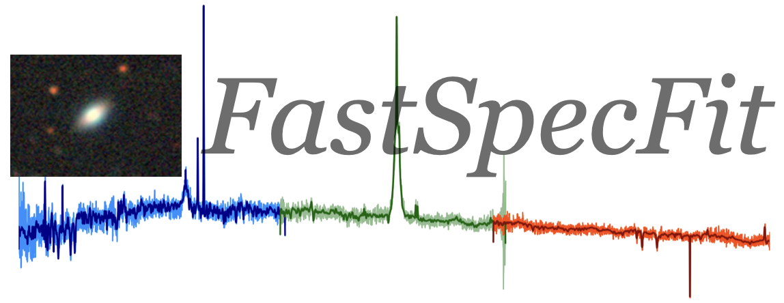

|Actions Status| |Coveralls Status| |Documentation Status| |ASCL Reference|

.. |Actions Status| image:: https://github.com/desihub/fastspecfit/workflows/CI/badge.svg
    :target: https://github.com/desihub/fastspecfit/actions
    :alt: GitHub Actions CI Status

.. |Coveralls Status| image:: https://coveralls.io/repos/desihub/fastspecfit/badge.svg?branch=main
    :target: https://coveralls.io/github/desihub/fastspecfit?branch=main
    :alt: Test Coverage Status

.. |Documentation Status| image:: https://app.readthedocs.org/projects/fastspecfit/badge/?version=latest
    :target: https://fastspecfit.readthedocs.io/en/latest/
    :alt: Documentation Status

.. |ASCL Reference| image:: https://img.shields.io/badge/ascl-2308.005-blue.svg?colorB=262255
    :target: https://ascl.net/2308.005
    :alt: ASCL Reference

This repository contains code and documentation for performing fast spectral
synthesis and emission-line fitting of `DESI`_ spectra and broadband
photometry. For extensive details please see the `latest documentation`_.

If you use any of the ``FastSpecFit`` value-added catalogs or data products in
your research, please cite `Moustakas et al. (2026)`_, which has been submitted
to *The Astronomical Journal*::

   @ARTICLE{2026arXiv261122914M,
     author = {{Moustakas}, John and {Buhler}, Jeremy and {Scholte}, Dirk and {Aguilar}, Jessica and {Ahlen}, Steven and {Anand}, Abhijeet and {Armengaud}, Eric and {Aviles}, Alejandro and {Bailey}, Stephen and {Beutler}, Florian and et al.},
     title = "{FastSpecFit: Spectrophotometric Modeling of 38 Million Extragalactic Targets from the Dark Energy Spectroscopic Instrument Second Data Release}",
     journal = {arXiv e-prints},
     keywords = {Astrophysics of Galaxies},
     year = 2026,
     month = nov,
     eid = {arXiv:2611.22914},
     pages = {arXiv:2611.22914},
     archivePrefix = {arXiv},
     eprint = {2611.22914},
     primaryClass = {astro-ph.GA},
     adsurl = {https://scixplorer.org/abs/2026arXiv261122914M},
     adsnote = {Provided by the SAO/NASA Astrophysics Data System}
   }

If you use the ``FastSpecFit`` code itself, please cite `Moustakas et al.
(2026)`_ and also include the following `ASCL software citation`_::

   @MISC{2023ascl.soft08005M,
     author = {{Moustakas}, John and {Buhler}, Jeremy and {Scholte}, Dirk and {Dey}, Biprateep and {Khederlarian}, Ashod},
     title = "{FastSpecFit: Fast spectral synthesis and emission-line fitting of DESI spectra}",
     keywords = {Software},
      howpublished = {Astrophysics Source Code Library, record ascl:2308.005},
     year = 2023,
     month = aug,
     eid = {ascl:2308.005},
     pages = {ascl:2308.005},
     archivePrefix = {ascl},
     eprint = {2308.005},
     adsurl = {https://ui.adsabs.harvard.edu/abs/2023ascl.soft08005M},
     adsnote = {Provided by the SAO/NASA Astrophysics Data System}
   }

John Moustakas gratefully acknowledges funding support for this work from the
U.S. Department of Energy, Office of Science, Office of High Energy Physics
under Award Number DE-SC0020086.

| John Moustakas
| Siena University

.. _`DESI`: https://desi.lbl.gov
.. _`FastSpecFit`: https://github.com/desihub/fastspecfit
.. _`latest documentation`: http://fastspecfit.readthedocs.org/en/latest/
.. _`Moustakas et al. (2026)`: https://scixplorer.org/abs/2026arXiv261122914M/abstract
.. _`ASCL software citation`: https://ui.adsabs.harvard.edu/abs/2023ascl.soft08005M/abstract
